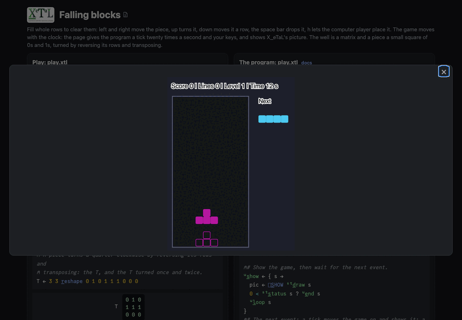

# Falling blocks

Fill whole rows to clear them. Left and right (or `a` and `d`) move the
piece, up (or `w`) turns it, down (or `s`) moves it down a row, the
space bar drops it. `h` lets the computer player place the piece. `r`
starts again. The pieces fall faster every ten lines; the game ends when
the next piece does not fit. The game moves with the clock, twenty
ticks a second. (The game is in the style of Tetris.)

Live: [the Falling blocks page](https://softwarewrighter.github.io/X_eTaL-games/blocks/)
-- Play opens the game in a dialog (close it with Escape, its X or a
click outside) and starts the clock;
[this link](https://softwarewrighter.github.io/X_eTaL-games/blocks/#play)
opens it at once. When the game ends, Play or any key starts a new one.



## How it works

- **The well is a matrix** (0 empty, else the kind of the piece that
  left a block there) **and a piece a small square of 0s and 1s.**
- **A piece turns by reversing its rows and transposing**:
  `l:t_urn := { M -> o_\ r_ev M }`. If it does not fit turned, it tries
  a column to either side.
- **A piece fits** where every one of its blocks lands inside the well
  on an empty cell: the blocks' cells are worked out at once from
  `w_here` of the shape, then looked up in the well.
- **Full rows are a row-wise and, and cleared by keeping the others**:
  `(n_ot full) r_eplicate W`, with as many empty rows put on top.
- **Where a piece lands** (for the drop and the outline that shows it)
  is every row below it tried at once, the first that does not fit.
- **The computer player** (`l:a_i`, and the `h` key) tries every turn
  and every column for the piece, each worked out to where it lands,
  and weighs the well each leaves: lines cleared for it; the columns'
  heights, the holes (a running or down each column, `'| s_\ F`, then
  the empty cells under it) and the bumps between columns against it.
- **The game is data.** `blocks.toml` holds the pieces (as rows of `#`
  and `.`), their colors, the well's size, the speeds and the points.
  `test.sh` adds an eighth piece there and checks it plays like the
  others.
- **The state is a tuple:** `(well, piece, kind, row, column, next,
  score, lines, seconds to the next step down, seconds played,
  standing)`.
- The clock's ticks and your keys come to `play.xtl` as `[]E_VENT`
  events (`tick 0.05`, `key LEFT`, `key space`), on the page as at the
  command line.

## Play it

```bash
just show blocks       # the scripted game as a notebook
just play blocks       # at the terminal: lines such as tick 0.05 and key LEFT
just test-game blocks  # compare with the expected output
```

At the terminal nothing falls until you type a `tick` line; the page
gives the ticks. The expected game (`expected/play.in`) places three
pieces by keys and the rest by the computer player.

## Assets

None.
