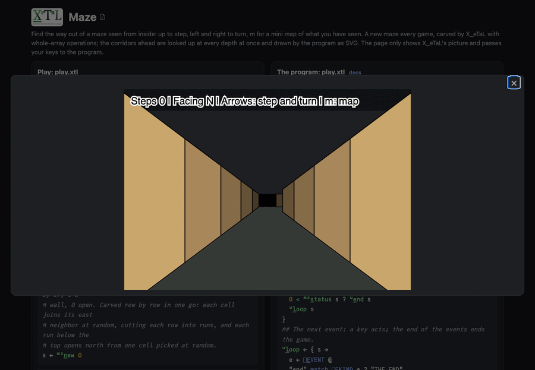

# Maze

Find the way out (`>`) of a maze seen from inside. Up (or `w`) steps
ahead, down (or `s`) steps back, left and right (or `a` and `d`) turn a
quarter. `m` shows or hides a mini map of what you have seen. `r`
starts a new maze. Every game is a new maze, carved from the game's
seed.

Live: [the Maze page](https://softwarewrighter.github.io/X_eTaL-games/maze/)
-- Play opens the maze in a dialog (close it with Escape, its X or a
click outside); [this link](https://softwarewrighter.github.io/X_eTaL-games/maze/#play)
opens it at once. When you find the way out, Play or any key starts a
new maze.



## How it works

- **The maze is one vector of blocks.** Each cell is a block, each pair
  of neighbors has a block between them (a wall or a way through), and
  a wall runs all around: 17 by 17 blocks for 8 by 8 cells, kept row by
  row as 0s and 1s.
- **Carved in one go** (the sidewinder way): every cell joins its east
  neighbor at random (the top row always, the last column never), which
  cuts each row into runs; each run below the top opens north from one
  of its cells. The runs are a running sum of where they end
  (`('+ s_\ ends) - ends`), and the cell that opens north is the one
  with the highest random key in its run, every pair of cells compared
  in one table:
  `'m_ax r_/_2 (0 + run '= t_able run) * (n c_at n) r_eshape key`.
- **The way out is the farthest point**, found by a flood: every open
  block's distance is one more than its nearest neighbor's, all at
  once, again until nothing changes (a fixed point). The notebook shows
  the whole table of distances.
- **The view is lookups at every depth at once.** From where you stand
  and the way you face, the blocks ahead and on each side at depths 0
  to 5 are one vector each (`at + k * step`); the first wall ahead cuts
  the view off; then the picture is drawn far to near: a slanted panel
  for a wall beside you, the face of the wall beyond an opening, the
  wall in front, the way out when it is in sight.
- **The mini map shows what you have seen**: every move adds the blocks
  in view to a mask of the blocks seen.
- **The state is a tuple:** `(walls, where you are, facing, steps,
  seen, map shown, way out)`.
- Keys come to `play.xtl` as `[]E_VENT` events (`key UP`), on the page
  as at the command line.

## Play it

```bash
just show maze       # the scripted game as a notebook
just play maze       # at the terminal: lines such as key UP
just test-game maze  # compare with the expected output
```

## Changing the maze

`maze.toml` holds the maze's size in cells (bigger is harder; `test.sh`
carves a 12 by 5 one) and the colors of the walls by depth, the floor
and the ceiling.

## Known X_eTaL issue

The blocks seen are kept as true/false and shown as such: making them
numbers with `0 +` stops with a type mismatch when the state comes back
from a function (an ask in [docs/xetal-asks.md](../../docs/xetal-asks.md)).

## Assets

None.
