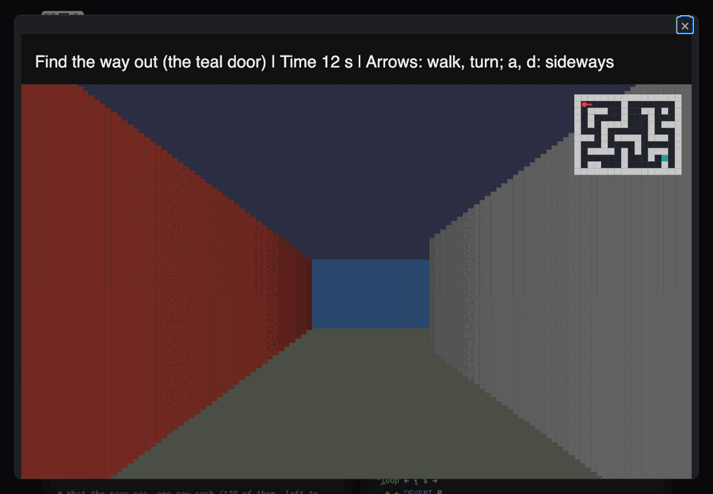

# Raycaster

Find the way out of the walls, seen from inside. Up (or `w`) steps
ahead, down (or `s`) steps back, left and right turn, `a` and `d` step
sideways. Walk into the teal door to get out. A mini map in the corner
shows where you are and which way you face. `r` starts again.

Live: [the Raycaster page](https://softwarewrighter.github.io/X_eTaL-games/raycaster/)
-- Play opens the game in a dialog (close it with Escape, its X or a
click outside) and starts the clock;
[this link](https://softwarewrighter.github.io/X_eTaL-games/raycaster/#play)
opens it at once. Once out, Play or any key starts again.



## How it works

The view is drawn the way the first 3D games drew theirs (ray casting),
written as arrays:

- **A ray for every column of the picture** (120 of them), fanned across
  the view: the way you face plus the camera plane times each column's
  place from -1 (left) to 1 (right), all at once.
- **Every ray is stepped through the grid at once.** Each knows the
  distance to its next line across and its next line down; each step,
  every ray that has not hit a wall moves to whichever is nearer
  (`across := (n_ot hit) & sx < sy`), and every ray looks at the tile it
  reached. The step repeats until all of them have hit a wall: a fixed
  point.
- **A wall is as tall as it is near.** Each ray's distance is measured
  along the way you face (not along the ray), so walls stand straight;
  a side struck going down is darker, and the farther, the darker.
- **Walking** is a step along the way you face (or across it, sideways),
  taken if your square fits there: its four corners tested at once.
- **The map is data.** `raycaster.toml` holds the map (digits are
  walls of four colors, `E` the door, `@` the start), the colors, and
  the step, the turn, the view's width and the number of rays.
  `test.sh` puts the game in an empty room.
- **The state is a tuple:** `(x, y, facing, seconds, standing)`.
- The clock's ticks and your keys come to `play.xtl` as `[]E_VENT`
  events (`tick 0.05`, `key UP`), on the page as at the command line.

From `Rays.xtl`, one step of every ray at once:

```
across := (n_ot hit) & sx < sy
down := (n_ot hit) & n_ot across
mx := mx + ix * 0 + across
my := my + iy * 0 + down
sx := sx + fa * dx
sy := sy + fd * dy
```

## Play it

```bash
just show raycaster       # the scripted game as a notebook
just play raycaster       # at the terminal: lines such as tick 0.05 and key UP
just test-game raycaster  # compare with the expected output
```

At the terminal nothing moves until you type a key line; the page gives
the ticks. The expected game (`expected/play.in`) walks out by a
shortest path in 20 seconds.

## Assets

None.
