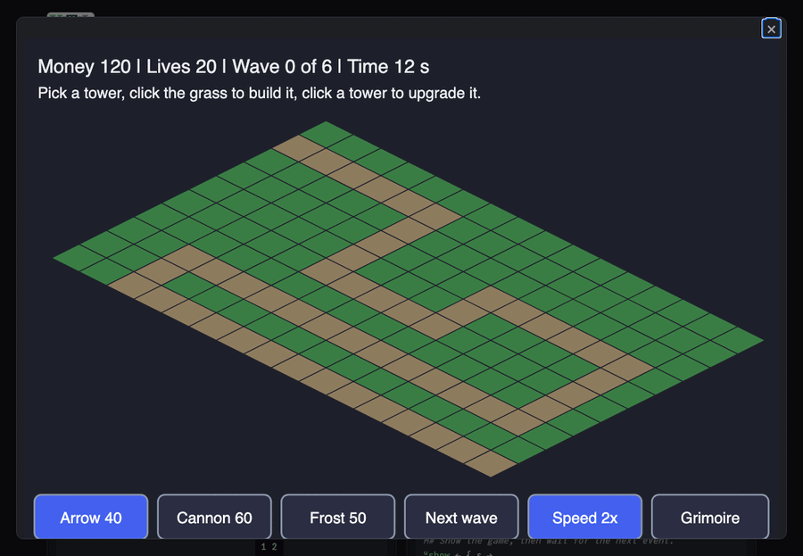

# Tower defense

Stop the creeps on the road before they get out. Pick a tower on the
toolbar (or `1`, `2`, `3`; left and right step through them) and click
a grass tile to build it there; click a tower to upgrade it (three
levels each). **Next wave** (or the space bar) sends the next wave when
you are ready; **Speed** (or `f`) runs the game 1, 2 or 4 times as fast;
the **Grimoire** (or `g`) shows every tower and creep, turning, with
what it does and what its upgrade costs. Six waves to beat, 20 lives; a
creep that gets out costs lives. The line under the top says what your
last click did (built, upgraded, or what is missing).

| Tower | Does |
| ----- | ---- |
| Arrow (40) | quick single shots; upgrades reach farther and shoot faster |
| Cannon (60) | slow shots that hurt every creep near where they land |
| Frost (50) | little damage, but slows the creeps it hits (and, upgraded, those near them) |

| Creep | Is |
| ----- | -- |
| Runner | fast and frail |
| Brute | slow, many hit points, costs 3 lives if it gets out |
| Shield | armored: each hit does its damage less 4 (never below 1); cannons crack it |

Live: [the Tower defense page](https://softwarewrighter.github.io/X_eTaL-games/tower-defense/)
-- Play opens the game in a dialog (close it with Escape, its X or a
click outside) and starts the clock;
[this link](https://softwarewrighter.github.io/X_eTaL-games/tower-defense/#play)
opens it at once. When the game ends, Play or any key starts a new one.



## How it works

- **2D underneath, 2.5D on screen.** The game is a grid of tiles and a
  road; the picture is an isometric god's-eye view: every point of the
  board is turned into the picture by one linear map (`OX + TW * x - y`,
  `OY + TH * x + y`), and a click is turned back into a tile by its
  inverse. A click on a tower's box, which stands up over the tiles
  behind it, counts for the tower: every tower's box is tested at once.
- **The road is found by a flood.** Every road tile's distance to E,
  each one more than its nearest road neighbor, all at once until
  nothing changes; sorted farthest first, the tiles are the way along
  the road. A creep is a number (how far it has come), and its place on
  the board is worked out from that for every creep at once.
- **Every tower against every creep is one table** (towers down, creeps
  across): which creeps each tower reaches, and for each ready tower the
  one in reach that has come farthest. A shot is spawned for each.
- **Every hitting shot against every creep is another table**: the
  target, and with a splash every creep near where the shot lands,
  takes its damage less its armor (never below 1); a frost hit slows
  them. Built on [`lib/Ecs`](../../lib/README.md): creeps, towers and
  shots are rows of one world, spawned and despawned by masks.
- **The game is data.** `td.toml` holds the map (the road is wherever
  `=` is), the towers' numbers at each level, the creeps', the waves and
  the start.
- **The state is a tuple:** `(world, money, lives, waves begun, creeps
  to come, seconds to the next, tower picked, view, grimoire page,
  seconds played, standing, speed, message)`.
- Ticks, clicks and keys come to `play.xtl` as `[]E_VENT` events
  (`tick 0.05`, `click 384 192`, `key space`), on the page as at the
  command line.

## The pieces' art

The towers and creeps are 3D models made by
[X_eTaL-extensions](https://github.com/softwarewrighter/X_eTaL-extensions):
an X_eTaL program drives Blender to build, animate, render and export
them ([`game-assets.xtl`](https://github.com/softwarewrighter/X_eTaL-extensions/blob/main/extensions/blender/demos/game-assets.xtl),
the pieces in [`Td.xtl`](https://github.com/softwarewrighter/X_eTaL-extensions/blob/main/extensions/blender/demos/Td.xtl);
see them turning and playing their clips on
[the extensions' page](https://softwarewrighter.github.io/X_eTaL-extensions/blender/td/)).
What was asked is in [docs/extensions-ask.md](../../docs/extensions-ask.md).

`assets/fetch.sh` fetches the twelve pieces (a `.glb` and a preview
picture each, pinned by commit and SHA-256) into the git-ignored
`assets/cache/art/`; the pages build copies them next to the page.
With `art = "1"` in `td.toml`, the game's X_eTaL draws each piece's
picture on the board and in the grimoire, and also describes the board
as a **3D scene**: JSON in the picture's `<metadata id="scene">`, with a
camera that sees the board exactly as the picture's isometric map does
(30 degrees up, 45 picture units a tile), the tiles, and every piece's
model, place, heading, clip and time (towers `idle`, or `fire` just
after a shot; creeps `walk`, facing along the road). The page draws that
scene with three.js behind the picture and hides the picture's flat
board and pieces (marked `flat`), so the labels, hit points, toolbar
and grimoire stay the program's SVG and clicks work as before; where
three.js or WebGL is missing, the flat picture stays. In the grimoire
the piece stands in a window of the panel, turning. With `"0"` the game
draws its own boxes and balls.

## Play it

```bash
just show tower-defense       # the scripted game as a notebook
just play tower-defense       # at the terminal: lines such as tick 0.05, click 384 192, key space
just test-game tower-defense  # compare with the expected output
```

At the terminal nothing moves until you type a `tick` line; the page
gives the ticks.

## Known X_eTaL issue

The grass is kept as 1s and 0s made where the map is read: adding 0 to
a named true/false value stops with a type mismatch (the ask in
[docs/xetal-asks.md](../../docs/xetal-asks.md) about a comparison being
a number in one place and Bool in another).

## Assets

The twelve pieces from X_eTaL-extensions (MIT), fetched by
`assets/fetch.sh` (see The pieces' art); never committed here.
